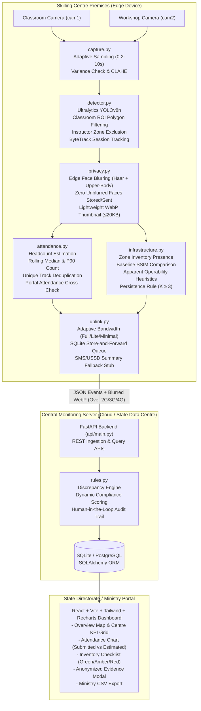

# SkillSight — System Architecture Specification

## 1. High-Level Architecture Overview

SkillSight is an edge-first compliance and video analytics platform engineered for government skilling schemes (such as PMKVY, DDU-GKY, and state skill missions). It solves two persistent integrity challenges:
1. **Attendance Inflation**: Centres submitting trainee attendance counts that fail to match actual physical headcount.
2. **Ghost Infrastructure**: Sanctioned equipment (machinery, workbenches, computers, seating) being removed or remaining inoperable between periodic physical inspections.

SkillSight runs all computer vision inference locally on CPU-friendly edge hardware situated at the training centre. **Raw CCTV video never leaves the training centre.** Only aggregated compliance events and edge-anonymized thumbnails are transmitted over low-bandwidth links to the central monitoring API and dashboard.

---

## 2. End-to-End Pipeline Diagram

---

## 3. Component Breakdown

### A. Edge Agent (`edge_agent/`)
- **`capture.py`**:
  - Handles RTSP feeds and local video files via OpenCV.
  - Dynamically samples frames at configurable intervals (10s default, 30s in low-bandwidth mode).
  - Evaluates frame variance ($Var < 20.0$ flags camera obstruction or dark frame).
  - Employs **CLAHE** (Contrast Limited Adaptive Histogram Equalization) on the luminance channel for low-light enhancement.
- **`detector.py`**:
  - Runs CPU-optimized YOLOv8n inference with ByteTrack multi-object tracking.
  - Performs geometric polygon containment testing (`pointPolygonTest`) against `classroom_roi`. People in hallways or outside doorways are discarded.
  - Automatically isolates the teaching lectern (`instructor_zone`) to exclude instructors from student headcount.
- **`privacy.py`**:
  - Enforces edge-only face blurring using OpenCV Haar Cascades and upper-body head region blurring.
  - Encodes evidence thumbnails directly to compressed WebP (320px wide, $\le 20\text{ KB}$).
  - Executes `verify_zero_unblurred_faces` to guarantee zero unblurred faces in any transmitted media.
- **`attendance.py`**:
  - Aggregates per-frame trainee counts across session windows.
  - Reports rolling median, 90th percentile (`p90`), and unique ByteTrack track estimates.
  - Cross-references with portal submitted attendance and triggers `ATTENDANCE_OVERREPORT` or `SESSION_EMPTY`.
- **`infrastructure.py`**:
  - Evaluates presence of countable items (workbenches, chairs) and fixed machinery (lathes, CNCs).
  - Uses Structural Similarity Index (SSIM) against reference baseline snapshots (`configs/baselines/`).
  - Evaluates **apparent operability** via person presence, frame differencing motion analysis, and indicator LED color detection.
  - Requires persistence across $\ge K$ consecutive checks ($K = 3$) before raising alerts.
- **`uplink.py`**:
  - Implements an on-disk SQLite queue (`edge_agent/offline_queue.db`) for resilient store-and-forward.
  - Manages adaptive bandwidth modes (Full, Lite, Minimal).
  - Generates ultra-compact SMS/USSD strings ($< 140\text{ characters}$) for rural 2G fallback.

### B. Central Backend API (`api/`)
- **`main.py`**:
  - Built with **FastAPI** providing high-throughput async REST endpoints.
  - Provides endpoints for real-time edge ingestion (`/api/v1/uplink/event`, `/api/v1/uplink/batch`).
  - Provides query endpoints for centres, alerts, and CSV reporting.
- **`models.py`**:
  - Clean **SQLAlchemy** declarative models (`Centre`, `Camera`, `SessionRecord`, `Alert`, `InventoryItem`).
  - Easily swappable from SQLite to production PostgreSQL via connection string.
- **`rules.py`**:
  - Discrepancy engine transforming raw vision observations into auditable compliance alerts.
  - Computes dynamic centre compliance scores ($0 - 100$) with penalty relief upon review.
  - Manages alert lifecycle: `open` $\rightarrow$ `acknowledged` $\rightarrow$ `resolved` with immutable reviewer notes.

### C. Monitoring Dashboard (`dashboard/`)
- Built with **React 18 + Vite + Tailwind CSS + Recharts**.
- Provides four primary operational views:
  1. **Overview View**: High-level KPIs, compliance score badges, search filters, camera status.
  2. **Centre Deep-Dive**: Submitted vs Estimated attendance area chart, sanctioned inventory checklist with green/amber/red status chips.
  3. **Evidence Modal**: Anonymized blurred evidence thumbnail viewer, rule threshold breakdown, audit trail timeline, review notes form.
  4. **Ministry Export**: Instant CSV download for state or central ministry compliance reports.

---

## 4. Security & Privacy Boundaries

| Layer | Security & Privacy Guarantees |
| :--- | :--- |
| **Raw Video Stream** | Confined strictly to RAM on local edge device. Never written to disk unblurred; never uploaded. |
| **Edge Storage** | Ephemeral ByteTrack IDs reset every session. No facial embeddings generated or stored. |
| **Uplink Transmission** | HTTPS REST payloads containing aggregate integers and blurred thumbnails ($\le 20\text{ KB}$). |
| **Central Database** | Relational records of counts, audit logs, and anonymized evidence. Zero PII. |
